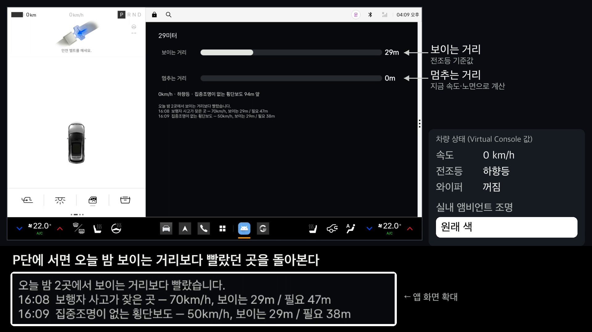
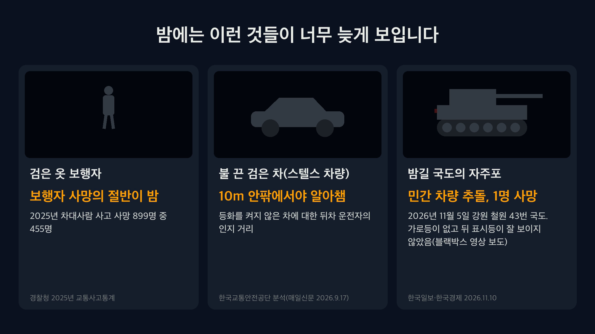

# 29미터

**밤길에 하향등으로 어두운 옷의 보행자를 알아볼 수 있는 거리(공단 시험 29m)보다 지금 속도로 멈추는 데 필요한 거리가 길어지는 순간에만, 실내 앰비언트 조명과 짧은 음성 한 번으로 알려 주는 야간 보행자 안전 앱.** 보행자를 감지하는 앱이 아니라, 못 볼 수 있는 속도를 알려 주는 앱입니다.

현대자동차그룹 차량용 앱 개발 공모전(Pleos Connect) 출품작입니다.


| 왜 필요한가 | 비 오는 밤 장면 | 정차 후 돌아보기 |
|---|---|---|
|  |  |  |

시연 영상(2분 53초): 접수 메일에 첨부 — 내레이션이 있는 컨셉 설명(약 80초: 밤에 늦게 보이는 것들 → 보이는 거리와 멈추는 거리 → 동작 원리)과 Pleos Connect 에뮬레이터 실제 화면 3장면. 에뮬레이터 소리는 녹화되지 않아 앱이 말한 문장을 macOS 음성으로 재현했고, 배경음악은 "Wallpaper" Kevin MacLeod (incompetech.com), CC BY 4.0.

밤에는 검은 옷의 보행자만 늦게 보이는 것이 아닙니다. 등화를 켜지 않은 차는 뒤차가 10m 안팎에서야 알아채고(한국교통안전공단 분석, 매일신문 2026-09-17), 2026년 11월 5일 밤 강원 철원 43번 국도에서는 뒤 표시등이 잘 보이지 않던 육군 자주포를 민간 차량이 잇따라 들이받아 1명이 숨졌습니다(한국일보·한국경제 2026-11-10 보도, 경찰 수사 중). 29미터는 그중 보행자 사고가 잦은 곳에서, 지금 속도가 전조등으로 보이는 거리 안에서 멈출 수 있는지를 봅니다.



## 무엇을 하나

| 기능 | 하는 일 | 쓰는 차량 신호 |
|---|---|---|
| 보이는 거리 | 전조등이 켜져 있을 때 하향등 29m·상향등 79m(어두운 옷 기준). 전조등이 꺼진 낮에는 판정하지 않음 | 하향·상향등 상태 |
| 멈추는 거리 | 정지거리 = 속도×반응 1초 + 속도²/(2×마찰계수×9.81), 마찰계수 마른 0.7·젖은(와이퍼 작동) 0.4 | 차속, 와이퍼 |
| 위험한 곳에서만 | 보행자 위험 지점 300m 앞(진행 방향 ±45°)에서만 판정. 공공데이터 24,098곳 + 내비 주의지점 | 위치·진행 방향, NaviHelper 주의지점 |
| 눈을 돌리지 않는 알림 | 멈추는 거리 > 보이는 거리면 앰비언트 조명을 호박색으로 바꾸고(밝기는 그대로, 꺼져 있었으면 밝기 40으로 켬), 그 지점에서 한 번만 짧게 말함. 풀리면 원래 색으로 복원하고, 경고 중 앱이 꺼져도 다음 시작 때 복원 | 앰비언트 조명 제어, TTS |
| 정차 후 돌아보기 | P단에서 오늘 밤 보이는 거리보다 빨랐던 곳 목록 | 기어 |

- 경고 규칙: 한 번 켜지면 멈추는 거리가 보이는 거리보다 3m 이상 짧아져야 꺼짐(깜빡임 방지). 음성은 같은 지점에서 10분에 한 번, 전체적으로 20초에 한 번까지.
- 음성 예: "보행자 사고가 잦은 곳, 275미터 앞. 지금 속도로는 하향등으로 보이는 거리 안에서 멈추기 어렵습니다. 맞은편 차와 앞차가 없으면 상향등을 쓸 수 있는지 확인하세요." 숫자(29m·47m)는 화면 막대에만 둡니다.
- 하이빔 보조(상향등 스위치 AUTO)가 켜져 있으면 상향등을 권하지 않고 감속만 안내.
- 앱은 보행자를 직접 감지하지 않습니다. '안전' 표시를 하지 않고, 위험할 수 있는 순간만 알립니다. 알림이 없다는 것이 안전하다는 뜻은 아니며, 운전자의 주의 의무를 대신하지 않는 보조 안내입니다.
- 주행 기록(지점·속도)은 기기 안 메모리에만 두고 밖으로 보내지 않습니다.

## APK

- **`apk/윤혁_29미터_release.apk`** (release 빌드, 심사 설치용으로 디버그 키 서명)

## 실행 방법

1. Pleos Connect 에뮬레이터를 **Cold boot**로 켭니다(Quick boot면 차량 데이터가 오지 않습니다).
2. APK를 권한과 함께 설치하고 실행합니다.
   ```sh
   adb install -r -g apk/윤혁_29미터_release.apk
   adb shell am start -n kr.meter29/.MainActivity
   ```
   `-g`는 차속(`android.car.permission.CAR_SPEED`)·위치 등 실행 권한을 미리 허용합니다. 빼면 첫 실행 때 권한 창이 뜹니다.
3. 시연 시나리오를 재생합니다(Virtual Console REST API + 에뮬레이터 GPS).
   ```sh
   bash demo/scenario.sh          # adb가 PATH에 없으면: ADB=/경로/adb bash demo/scenario.sh
   ```
   - 장면 1: 강원 철원군 동송읍 보행자 사고 다발지역에 하향등·70km/h로 접근 → 호박색 조명 + 음성 → 상향등을 켜면 해제
   - 장면 2: 충남 태안군 집중조명이 없는 횡단보도에 비(와이퍼)·50km/h로 접근 → 젖은 노면 정지거리 38m > 29m라 경고 → 감속하면 해제
   - 장면 3: P단 → 정차 후 돌아보기 목록
   - 접근 경로는 지점까지 곧게 이은 가상 경로입니다.

직접 조작할 때는 Virtual Console(브라우저 `http://127.0.0.1:8088`, `adb forward tcp:8088 tcp:8088`)에서 전조등(Exterior Lights Mode: Low beam, High Beam), 와이퍼, 기어, 속도를 바꾸고 `adb emu geo fix <경도> <위도>`로 위치를 옮기면 됩니다.

## 테스트 환경 및 필요한 설정

| 항목 | 값 |
|---|---|
| 에뮬레이터 | **Pleos Connect Emulator v2.1.0** — 시스템 이미지 "Pleos Connect v2.1.0 APIs arm64"(Android 14 / API 34), RAM 4GB, Cold boot |
| 화면 규격 | **2560 × 1440** (mdpi, 에뮬레이터 기본 기기 Pleos Connect v2.1.0) |
| 개발 환경 | macOS(Apple Silicon), JDK 17, Gradle 8.12(wrapper), AGP 8.7.3, Kotlin 2.0.21 |
| 앱 | minSdk 28, targetSdk 35, `useLibrary("android.car")` |
| 필요한 권한 | `android.car.permission.CAR_SPEED`, `CAR_POWERTRAIN`, `pleos.car.permission.CAR_LIGHTS`·`CONTROL_CAR_LIGHTS`·`CAR_WINDOWS`·`FUSED_LOCATION`·`NAVI_ROUTE`·`TTS_SERVICE`, 위치, 알림 |
| 서버·API 키 | 필요 없음(공공데이터는 앱 안에 포함) |

## 사용한 Pleos Connect SDK·API

| 구분 | 사용 | 용도 |
|---|---|---|
| Vehicle SDK 2.3.2 (Light) | `getCurrentLowBeamLightState`, `getCurrentHighBeamLightState`, `registerLowBeamLightState`, `registerHighBeamLightState`, `getHighBeamLightSwitch` | 보이는 거리, 하이빔 보조 여부 |
| Vehicle SDK (Wiper) | `getCurrentWiperState`, `registerWiperState` | 젖은 노면 |
| Vehicle SDK (Light 제어) | `setAmbientLightBrightnessColor`, `setAmbientLightBrightness`, `setAmbientLightSwitch`(원래 값은 `get…`으로 저장해 복원) | 호박색 알림 |
| AAOS Car API | `PERF_VEHICLE_SPEED`, `GEAR_SELECTION` (`CarPropertyManager`) | 멈추는 거리, 주행·정차 |
| NaviHelper SDK 3.0.5 | `onCautionPointInfo` (SCHOOL_ZONE·ACCIDENT_PRONE_AREA·NARROW_ROAD) | 내비 주의지점 |
| FusedLocation SDK 1.1.3 | `registerFusedLocationCallback` (안 되면 안드로이드 GPS) | 위치·진행 방향 |
| TextToSpeech SDK 3.3.1 | 온디바이스(`Mode.ON_DEVICE`) 한국어 | 음성 안내 |

## 공공데이터 (앱 안 `app/src/main/assets/zones.json`, 24,098곳)

| 이름(음성 안내에 쓰임) | 지점 수 | 출처 |
|---|---|---|
| 보행자 사고가 잦은 곳 | 2,223 | 도로교통공단 교통사고분석 개방포털 '보행자 교통사고 다발지역' |
| 어르신 보행 사고가 잦은 곳 | 664 | 공공데이터포털 전국교통사고다발지역표준데이터 '보행노인', 2022년 이후 |
| 어린이 보행 사고가 잦은 곳 | 348 | 같은 데이터 '보행어린이'·'스쿨존어린이', 2022년 이후 |
| 집중조명이 없는 횡단보도 | 20,863 | 공공데이터포털 전국횡단보도표준데이터, 집중조명시설유무 'N'(제공 지자체 일부) |

다시 만들기: `DATA_GO_KR_SERVICE_KEY=<키> python3 tools/fetch_public_data.py <폴더>` → 개방포털 CSV(`19_25_pedstrians.csv`)를 같은 폴더에 넣고 → `python3 tools/make_zones.py <폴더> app/src/main/assets/zones.json`.

## 빌드·테스트

```sh
export JAVA_HOME=<JDK 17 경로>
./gradlew :app:testDebugUnitTest     # 판정 엔진 단위 테스트 44개
./gradlew :app:assembleRelease       # app/build/outputs/apk/release/app-release.apk
```

## 구조

```
app/src/main/java/kr/meter29/
  core/       판정 엔진(순수 Kotlin, 단위 테스트) — Distances, Zones, Advisor, Phrases
  vehicle/    차량 신호 어댑터 — Vehicle SDK·CarPropertyManager·FusedLocation·NaviHelper
  output/     알림 — 앰비언트 조명·TTS
  ui/         보이는 거리/멈추는 거리 막대
  GuardService.kt  1초마다 신호 → 판정 → 알림(포그라운드 서비스, 별도 스레드)
  MainActivity.kt  주행 중 막대+한 줄, 정차(P) 중 돌아보기
tools/        공공데이터 받기·변환
demo/         시연 시나리오
```

## 수치의 출처와 한계

- 보이는 거리 29m·43m(흰 옷)·79m: 한국교통안전공단 보도자료(2023-11-30). 원문 단서 — 캠페인 목적의 시험, 시험자 1명의 주관적 판단, 공식 시험결과 아님.
- 정지거리 가정(반응 1초, 마찰계수 0.7/0.4)은 국내 도로 설계기준의 최소 정지시거(50km/h 60m)보다 짧게 잡은 값이라, 앱은 분명한 경우에만 알립니다.
