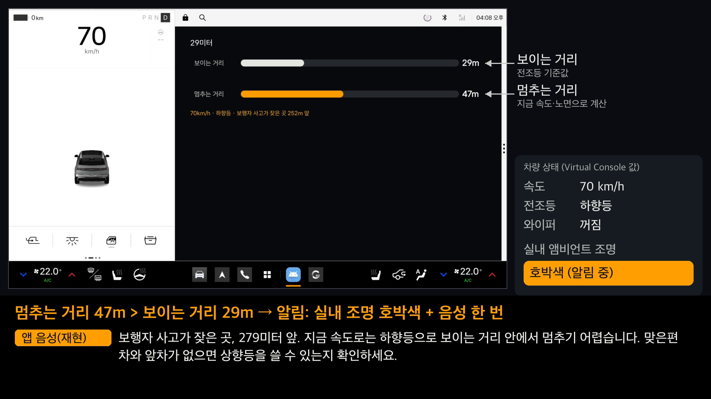
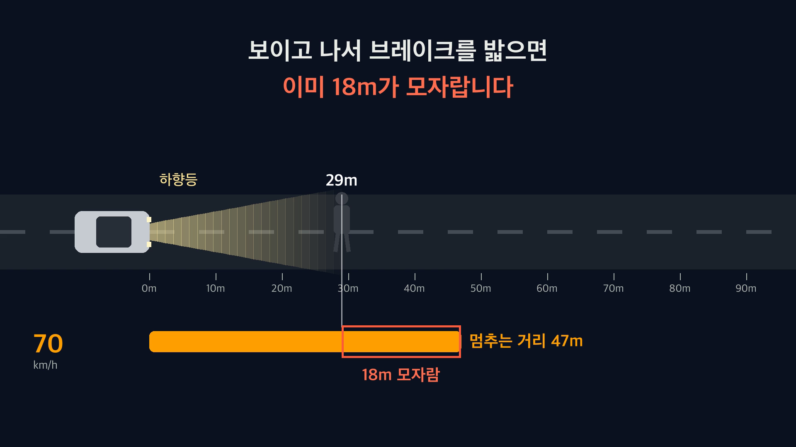
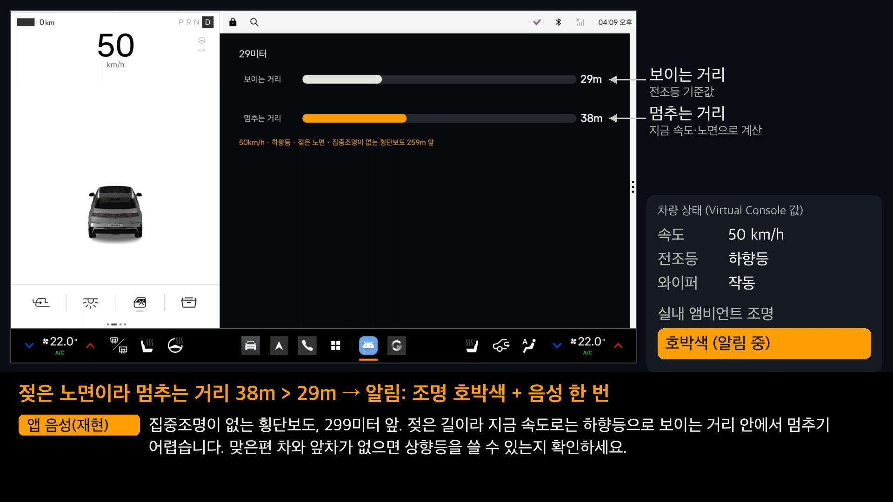

# 29미터

밤에 하향등으로 검은 옷 보행자가 보이는 거리(한국교통안전공단 시험 29m)보다 지금 속도의 정지거리가 길어지면, 실내 조명 색과 짧은 음성으로 알려 주는 Pleos Connect 앱입니다. 현대자동차그룹 차량용 앱 개발 공모전 출품작입니다.



| 밤에 늦게 보이는 것들 | 정지거리와 보이는 거리 | 비 오는 밤 | 정차 후 돌아보기 |
|---|---|---|---|
|  |  |  |  |

## 만든 이유

밤에는 전조등을 켜도 검은 옷을 입은 사람이 바로 앞에 와서야 보입니다. 한국교통안전공단 시험에서 하향등으로 검은 옷 보행자를 알아본 거리는 29m였습니다(앱 이름도 여기서 따왔습니다). 반응 1초, 마른 노면으로 잡아도 70km/h의 정지거리는 47m라서, 사람이 보인 뒤 브레이크를 밟아서는 그 앞에 서기 어렵습니다.

사람만 그런 것은 아닙니다. 등화를 켜지 않은 차는 뒤차가 10m 안팎에서야 알아챈다는 분석이 있고(한국교통안전공단, 매일신문 2026-09-17), 2026년 11월 5일 밤 강원 철원 43번 국도에서는 뒤 표시등이 잘 보이지 않던 육군 자주포를 민간 차량이 잇따라 들이받아 1명이 숨졌습니다(한국일보·한국경제 2026-11-10, 경찰 수사 중).

이 앱은 그중 보행자를 다룹니다. 보행자 사고가 잦은 곳과 조명 없는 횡단보도 앞에서, 지금 속도로 전조등이 비추는 거리 안에 멈출 수 있는지를 확인합니다.

## 동작 방식

| 항목 | 내용 | 쓰는 차량 신호 |
|---|---|---|
| 보이는 거리 | 하향등 29m, 상향등 79m(어두운 옷 기준). 전조등이 꺼진 낮에는 판단하지 않음 | 하향·상향등 상태 |
| 정지거리(화면의 "멈추는 거리") | 속도 × 반응 1초 + 속도² / (2 × 마찰계수 × 9.81). 마찰계수는 마른 노면 0.7, 와이퍼가 돌면 0.4 | 차속, 와이퍼 |
| 위험 지점 | 보행자 위험 지점 300m 앞(진행 방향 ±45°)에서만 판단. 공공데이터 24,098곳 + 내비 주의지점 | 위치·진행 방향, NaviHelper 주의지점 |
| 알림 | 정지거리가 더 길면 앰비언트 조명을 호박색으로 바꾸고 그 지점에서 한 번 말함. 밝기는 그대로(꺼져 있었으면 40으로 켬). 풀리면 원래 색으로 돌리고, 알림 중 앱이 꺼져도 다음 실행 때 돌림 | 앰비언트 조명 제어, TTS |
| 정차 후 돌아보기 | P단에서 오늘 밤 보이는 거리 안에서 서기 어려운 속도로 지나간 곳 목록 | 기어 |

- 호박색은 정지거리가 보이는 거리보다 3m 이상 짧아져야 원래 색으로 돌아갑니다. 경계 속도에서 색이 오락가락하지 않게 하려는 것입니다. 음성은 같은 지점에서 10분에 한 번, 전체로는 20초에 한 번까지만 나옵니다.
- 음성 예: "보행자 사고가 잦은 곳, 275미터 앞. 지금 속도로는 하향등으로 보이는 거리 안에서 멈추기 어렵습니다. 맞은편 차와 앞차가 없으면 상향등을 쓸 수 있는지 확인하세요." 29m, 47m 같은 숫자는 화면 막대에만 표시합니다.
- 하이빔 보조(상향등 스위치 AUTO)를 쓰고 있으면 상향등 얘기는 빼고 속도를 줄이라고만 합니다.
- 보행자를 직접 감지하지는 않습니다. 알림이 없다고 안전하다는 뜻은 아니며, 운전자의 주의 의무를 대신하지 않습니다.
- 주행 기록(지점, 속도)은 기기 메모리에만 있고 밖으로 보내지 않습니다.

## APK

`apk/윤혁_29미터_release.apk` (release 빌드, 심사 설치용으로 디버그 키 서명)

## 실행 방법

1. Pleos Connect 에뮬레이터를 **Cold boot**로 켭니다. Quick boot로 켜면 차량 데이터가 들어오지 않습니다.
2. APK를 권한과 함께 설치하고 실행합니다.
   ```sh
   adb install -r -g apk/윤혁_29미터_release.apk
   adb shell am start -n kr.meter29/.MainActivity
   ```
   `-g`는 차속(`android.car.permission.CAR_SPEED`), 위치 같은 권한을 미리 허용합니다. 빼면 처음 실행할 때 권한 창이 뜹니다.
3. 시연 시나리오를 실행합니다. Virtual Console REST API와 에뮬레이터 GPS를 씁니다.
   ```sh
   bash demo/scenario.sh          # adb가 PATH에 없으면: ADB=/경로/adb bash demo/scenario.sh
   ```
   - 장면 1: 하향등, 70km/h로 강원 철원군 동송읍 보행자 사고 다발지역에 접근 → 호박색 조명과 음성 → 상향등을 켜면 꺼짐
   - 장면 2: 비(와이퍼), 50km/h로 충남 태안군 집중조명이 없는 횡단보도에 접근 → 젖은 노면 정지거리 38m > 29m라 알림 → 30km/h로 줄이면 꺼짐
   - 장면 3: P단 → 정차 후 돌아보기 목록
   - 지점은 실제 공공데이터 위치이고, 지점까지 가는 길은 직선으로 이은 가상 경로입니다.

직접 조작하려면 Virtual Console(`adb forward tcp:8088 tcp:8088` 후 브라우저에서 `http://127.0.0.1:8088`)에서 전조등(Exterior Lights Mode: Low beam, High Beam), 와이퍼, 기어, 속도를 바꾸고 `adb emu geo fix <경도> <위도>`로 위치를 옮기면 됩니다.

## 테스트 환경

| 항목 | 값 |
|---|---|
| 에뮬레이터 | **Pleos Connect Emulator v2.1.0**, 시스템 이미지 "Pleos Connect v2.1.0 APIs arm64"(Android 14 / API 34), RAM 4GB, Cold boot |
| 화면 규격 | **2560 × 1440** (mdpi, 에뮬레이터 기본 기기 Pleos Connect v2.1.0) |
| 개발 환경 | macOS(Apple Silicon), JDK 17, Gradle 8.12(wrapper), AGP 8.7.3, Kotlin 2.0.21 |
| 앱 | minSdk 28, targetSdk 35, `useLibrary("android.car")` |
| 권한 | `android.car.permission.CAR_SPEED`, `CAR_POWERTRAIN`, `pleos.car.permission.CAR_LIGHTS`·`CONTROL_CAR_LIGHTS`·`CAR_WINDOWS`·`FUSED_LOCATION`·`NAVI_ROUTE`·`TTS_SERVICE`, 위치, 알림 |
| 서버·API 키 | 없음(공공데이터는 앱 안에 포함) |

## 사용한 SDK·API

| 구분 | 사용 | 용도 |
|---|---|---|
| Vehicle SDK 2.3.2 (Light) | `getCurrentLowBeamLightState`, `getCurrentHighBeamLightState`, `registerLowBeamLightState`, `registerHighBeamLightState`, `getHighBeamLightSwitch` | 보이는 거리, 하이빔 보조 여부 |
| Vehicle SDK (Wiper) | `getCurrentWiperState`, `registerWiperState` | 젖은 노면 |
| Vehicle SDK (Light 제어) | `setAmbientLightBrightnessColor`, `setAmbientLightBrightness`, `setAmbientLightSwitch`(원래 값은 `get…`으로 저장해 복원) | 호박색 알림 |
| AAOS Car API | `PERF_VEHICLE_SPEED`, `GEAR_SELECTION` (`CarPropertyManager`) | 정지거리, 주행·정차 |
| NaviHelper SDK 3.0.5 | `onCautionPointInfo` (SCHOOL_ZONE·ACCIDENT_PRONE_AREA·NARROW_ROAD) | 내비 주의지점 |
| FusedLocation SDK 1.1.3 | `registerFusedLocationCallback` (안 되면 안드로이드 GPS) | 위치, 진행 방향 |
| TextToSpeech SDK 3.3.1 | 온디바이스(`Mode.ON_DEVICE`) 한국어 | 음성 안내 |

## 공공데이터

앱 안 `app/src/main/assets/zones.json`에 24,098곳이 들어 있습니다.

| 이름(음성 안내에 쓰임) | 지점 수 | 출처 |
|---|---|---|
| 보행자 사고가 잦은 곳 | 2,223 | 도로교통공단 교통사고분석 개방포털 '보행자 교통사고 다발지역' |
| 어르신 보행 사고가 잦은 곳 | 664 | 공공데이터포털 전국교통사고다발지역표준데이터 '보행노인', 2022년 이후 |
| 어린이 보행 사고가 잦은 곳 | 348 | 같은 데이터 '보행어린이'·'스쿨존어린이', 2022년 이후 |
| 집중조명이 없는 횡단보도 | 20,863 | 공공데이터포털 전국횡단보도표준데이터, 집중조명시설유무 'N'(일부 지자체만 제공) |

다시 만들려면 `DATA_GO_KR_SERVICE_KEY=<키> python3 tools/fetch_public_data.py <폴더>`로 받고, 개방포털 CSV(`19_25_pedstrians.csv`)를 같은 폴더에 넣은 뒤 `python3 tools/make_zones.py <폴더> app/src/main/assets/zones.json`을 실행합니다.

## 빌드·테스트

```sh
export JAVA_HOME=<JDK 17 경로>
./gradlew :app:testDebugUnitTest     # 판정 로직 단위 테스트 44개
./gradlew :app:assembleRelease       # app/build/outputs/apk/release/app-release.apk
```

## 폴더 구조

```
app/src/main/java/kr/meter29/
  core/       판정 로직(순수 Kotlin, 단위 테스트): Distances, Zones, Advisor, Phrases
  vehicle/    차량 신호: Vehicle SDK, CarPropertyManager, FusedLocation, NaviHelper
  output/     알림: 앰비언트 조명, TTS
  ui/         보이는 거리·정지거리 막대
  GuardService.kt  1초마다 신호 읽기 → 판정 → 알림(포그라운드 서비스, 별도 스레드)
  MainActivity.kt  주행 중 막대와 한 줄 설명, 정차(P) 중 돌아보기
tools/        공공데이터 받기·변환
demo/         시연 시나리오
```

## 수치 출처

- 보이는 거리 29m, 43m(흰 옷), 79m(상향등): 한국교통안전공단 보도자료(2023-11-30). 캠페인용 시험이고 시험자 1명이 판단한 값이라 공식 시험 결과는 아닙니다.
- 정지거리 가정(반응 1초, 마찰계수 0.7/0.4)은 국내 도로 설계기준의 최소 정지시거(50km/h에서 60m)보다 짧게 잡은 값입니다. 그래서 확실히 멈추기 어려운 경우에만 알립니다.

## 시연 영상

접수 메일에 첨부했습니다(2분 53초). 앞 약 80초는 내레이션으로 문제와 동작 원리를 설명하고, 뒤는 Pleos Connect 에뮬레이터 실제 화면 3장면입니다. 배경음악은 "Wallpaper" Kevin MacLeod (incompetech.com), CC BY 4.0입니다.
